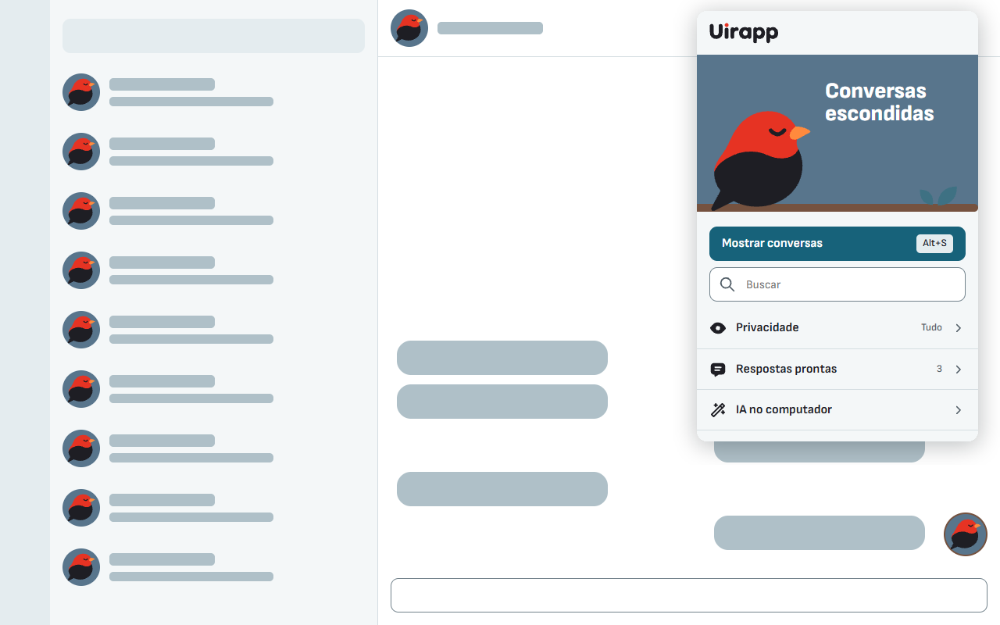
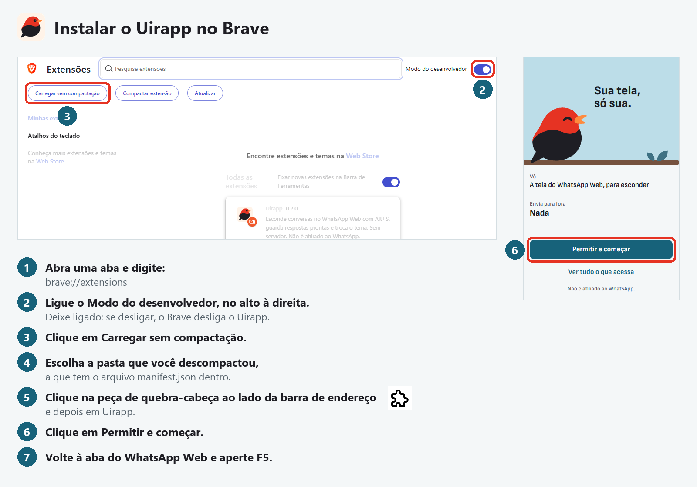
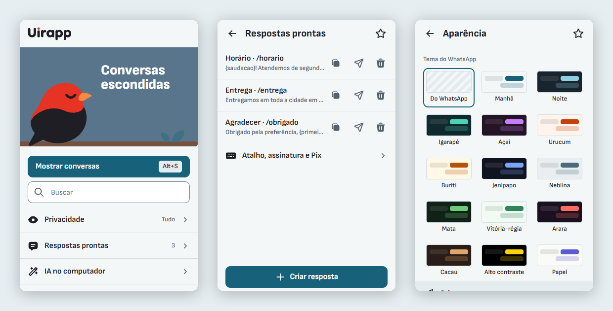
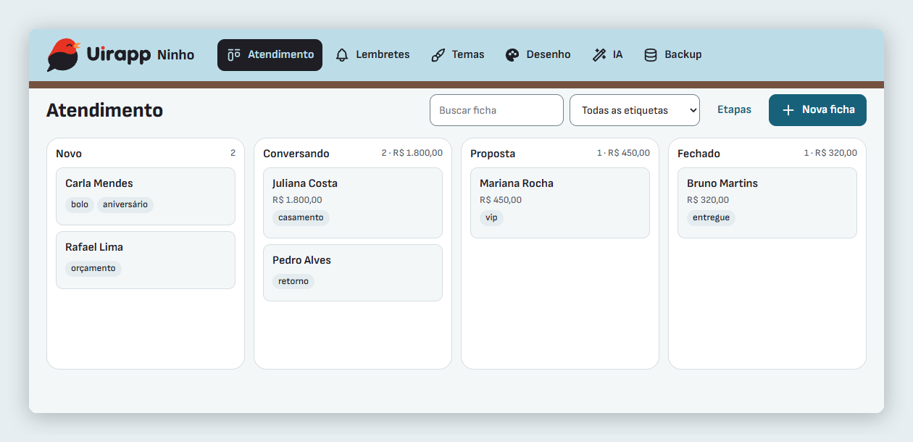
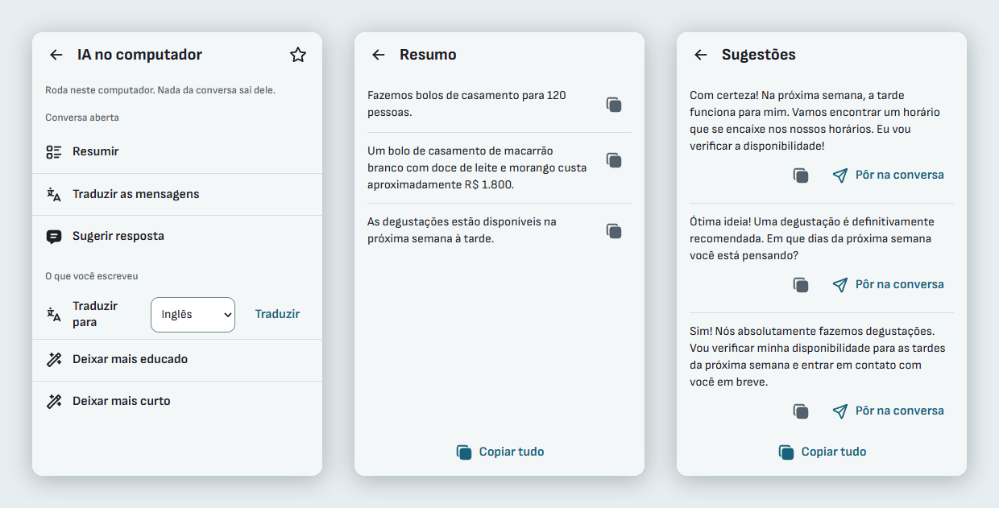

<!-- Traduzido de README.md em 2026-11-22 -->
<p align="center">
  <picture>
    <source media="(prefers-color-scheme: dark)" srcset="marca/logo-horizontal-escura.svg">
    
  </picture>
</p>

# Uirapp

Free WhatsApp Web extension: hide your chats with Alt+S, keep quick replies and change the theme. No server.

[Português](README.md) | **English**

[Download](#download) · [Install](#install) · [What it does](#what-it-does) · [Privacy](#privacy-and-permissions) · [Report a problem](https://github.com/FFloriani/uirapp/issues)

[](https://github.com/FFloriani/uirapp/releases/latest)
[](#compatibility)
[](https://github.com/FFloriani/uirapp/commits/main)



> [!NOTE]
> Uirapp is not on the Chrome Web Store yet. For now, install it from the ZIP file with Developer mode turned on.

## Why it exists

- **The problem:** opening WhatsApp Web at work, on a video call or with people around shows your chats. People who answer customers type the same reply all day long.
- **What changes:** one key covers the whole screen, and your replies, customer cards and themes stay in your browser, with no account and no server.
- **What it does not do:** it never sends a message for you, never schedules and never sends in bulk. Uirapp types into the chat box; you are the one who presses Enter.

## Download

| I want to | File | Note |
|---|---|---|
| Install on Brave or Chrome | [uirapp.zip](https://github.com/FFloriani/uirapp/releases/latest/download/uirapp.zip) | Unzip it into a folder you will keep |

SHA-256 in [SHA256SUMS.txt](https://github.com/FFloriani/uirapp/releases/latest/download/SHA256SUMS.txt) · Older versions in [Releases](https://github.com/FFloriani/uirapp/releases)

## Install



1. Download [uirapp.zip](https://github.com/FFloriani/uirapp/releases/latest/download/uirapp.zip) and unzip it into a fixed folder, for example `Documents\uirapp`.
2. Open a tab and type `brave://extensions` (on Chrome, `chrome://extensions`).
3. Turn on **Developer mode**, top right. Keep it on: if you turn it off, the browser disables Uirapp.
4. Click **Load unpacked** and pick the folder you unzipped, the one with the `manifest.json` file inside.
5. Click the puzzle piece next to the address bar, then **Uirapp**.
6. Click **Allow and start**. The extension follows your browser language (English, Portuguese or Spanish), so on a Portuguese browser this button reads **Permitir e começar**.
7. Go back to the WhatsApp Web tab and press **F5**.

To check it works: press **Alt+S** on the WhatsApp Web tab. Your chats turn into sleeping birds; press Alt+S again to show everything.

<details>
<summary>Update to a new version</summary>

1. Download the new `uirapp.zip` and unzip it **over the same folder**, replacing the files.
2. On `brave://extensions`, click the reload arrow on the Uirapp card.
3. Go back to the WhatsApp Web tab and press F5.

Using the same folder keeps your settings, replies and customer cards. Removing the extension deletes them: make a backup in the Ninho page first.

</details>

## What it does



- **Silence.** Alt+S hides messages, previews, names, photos and media, all of them or only the ones you pick. It can turn on by itself when you open the tab, when you leave it, or after 1, 5, 10 or 30 minutes idle. It also mutes the tab and removes the unread count from the title.
- **Quick replies.** Type `/shortcut` and press Tab inside the chat. Variables work too: `{saudacao}`, `{primeiro_nome}`, `{nome}`, `{data}`, `{hora}`, `{dia}`, `{assinatura}` and `{pix}`, which builds a Brazilian Pix copy-and-paste payment code with your key.
- **AI on this computer.** In Google Chrome, it summarizes the open chat, translates the messages, suggests three replies, and translates what you wrote or makes it more polite or shorter. It uses Chrome's own AI, on this computer: the chat never leaves it, and Uirapp only reads it when you ask.
- **Appearance.** 14 WhatsApp themes, a studio to build your own with a background image, text size, and the option to remove the filters, banners, Status, Channels, Communities, Calls and the background doodles.
- **Tools.** Chat with a number without saving the contact, **Compartilhar no WhatsApp** (share on WhatsApp, the menu item is in Portuguese) from the right-click menu on any page, export the open chat as text, spreadsheet or web page (the web page can have a password) and download the open photo or video.
- **Ninho.** A page of its own with a customer pipeline (cards, tags and amounts), reminders with desktop notifications, drawing, and a password-protected backup.
- **Languages.** The extension speaks Portuguese, English and Spanish.





The AI downloads once, about 4 GB, in the **IA** tab of the Ninho. Chrome's model does not speak Portuguese, so for Portuguese Uirapp translates to English and back, also on the computer; the text can read like a translation. In English and Spanish it works directly.

## Privacy and permissions

Uirapp has no server, no account and no telemetry. The extension pages are not allowed to open connections (`connect-src 'none'`), and the automated test checks that no request leaves the extension. It does not store your chats: it only keeps your settings and what you wrote yourself (replies, customer cards, reminders and themes). The AI reads the open chat only when you tap one of its actions, runs in Chrome on this computer, and what it answers is not stored. In **What Uirapp accesses**, in the popup, the **Delete Uirapp data** button erases everything.

| The browser asks for | What for |
|---|---|
| Read and change data on `web.whatsapp.com` | Hide the screen, apply the theme and type the reply in the chat box. It runs on no other site |
| `storage` | Keep your settings in the browser |
| `scripting` | Reinforce the hiding style so the site cannot override it |
| `contextMenus` | The **Compartilhar no WhatsApp** item in the right-click menu |
| `alarms` and `notifications` | Alert you when a reminder is due |

What it does **not** hide: desktop notifications and anything that appears after you disable or remove the extension and reload the page. For notifications, turn them off in WhatsApp Web itself.

Security rules and how to report a vulnerability are in [SECURITY.md](SECURITY.md).

## Compatibility

- Tested on **Brave** and **Google Chrome**. The package requires Chromium 120 or newer; other Chromium browsers were not tested.
- **AI on this computer** needs Google Chrome 138 or newer, 22 GB free and a graphics card with more than 4 GB or 16 GB of memory ([Google's requirements](https://developer.chrome.com/docs/ai/get-started)). Brave does not have it: the AI screen explains this and shows no actions.
- WhatsApp Web on a computer only. The phone app and the Windows app are not affected.
- When WhatsApp Web changes its page and Uirapp no longer recognizes what to hide, it covers the whole screen and says **WhatsApp changed** instead of leaving anything visible. If that happens, [open an issue](https://github.com/FFloriani/uirapp/issues/new/choose) with the date and your browser, without screenshots of your chats.

## Status

Made by one person. It works and has automated tests, but it is early: expect changes in every version. What changed is listed in [CHANGELOG.md](CHANGELOG.md).

## Build from source

Requires Python 3 with Pillow and PyYAML (tested on Python 3.14).

```powershell
git clone https://github.com/FFloriani/uirapp.git
cd uirapp
python -m pip install pillow pyyaml
python scripts/montar.py
```

Expected output: `montado`. The built extension lands in `extensao/uirapp` and the package in `extensao/uirapp-<version>.zip`. Tests and the folder layout are in [CONTRIBUTING.md](CONTRIBUTING.md) (in Portuguese).

## Contributing

Bug reports and ideas are welcome in the [issues](https://github.com/FFloriani/uirapp/issues), in English or Portuguese. Before sending code, open an issue so we can agree on it: see [CONTRIBUTING.md](CONTRIBUTING.md).

## Credits

- [Sofia Sans](https://github.com/lettersoup/Sofia-Sans) font, SIL OFL 1.1 license ([`ui/fontes/OFL-sofia-sans.txt`](ui/fontes/OFL-sofia-sans.txt)).
- [Tabler Icons](https://tabler.io/icons) 3.51.0, MIT license ([`ui/icones/LICENSE-tabler.txt`](ui/icones/LICENSE-tabler.txt)).
- The name comes from the uirapuru, the bird of the Amazon legend whose song makes the forest go silent.

Uirapp is not affiliated with, sponsored or endorsed by WhatsApp or Meta. WhatsApp is a trademark of WhatsApp LLC.

## License

No open license yet: the code is public to read, and all rights are reserved by the author. The third-party font and icons follow their own licenses, listed above.
