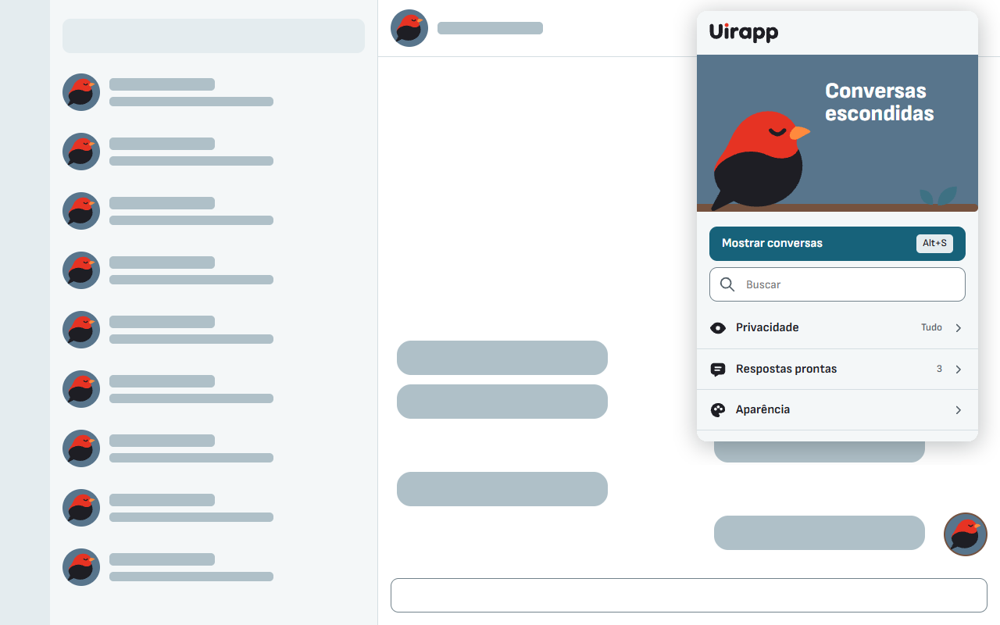
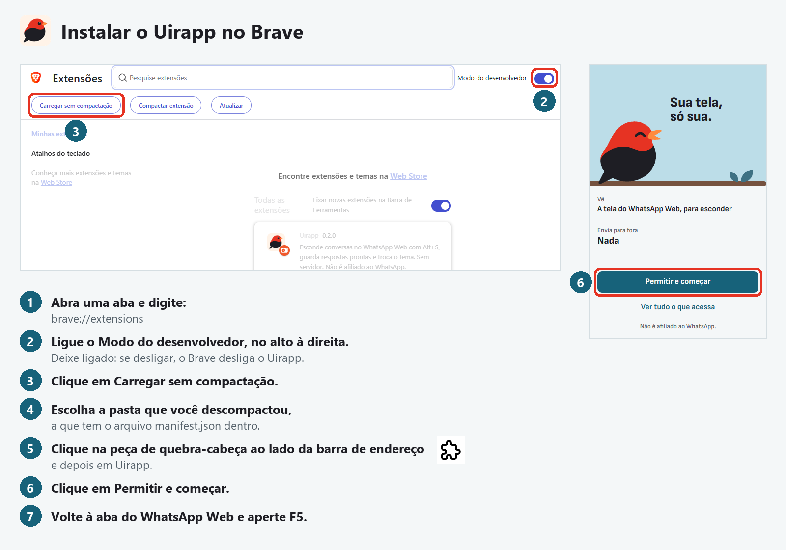
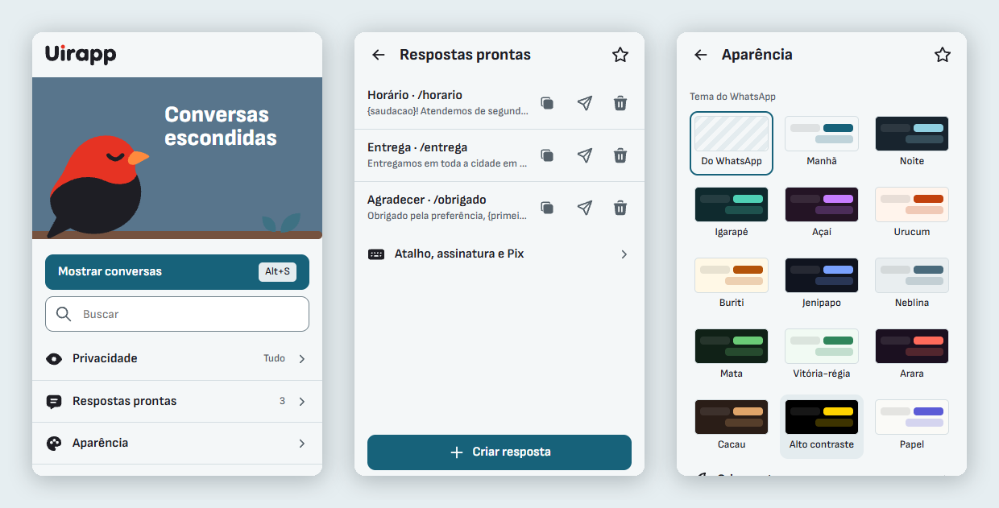
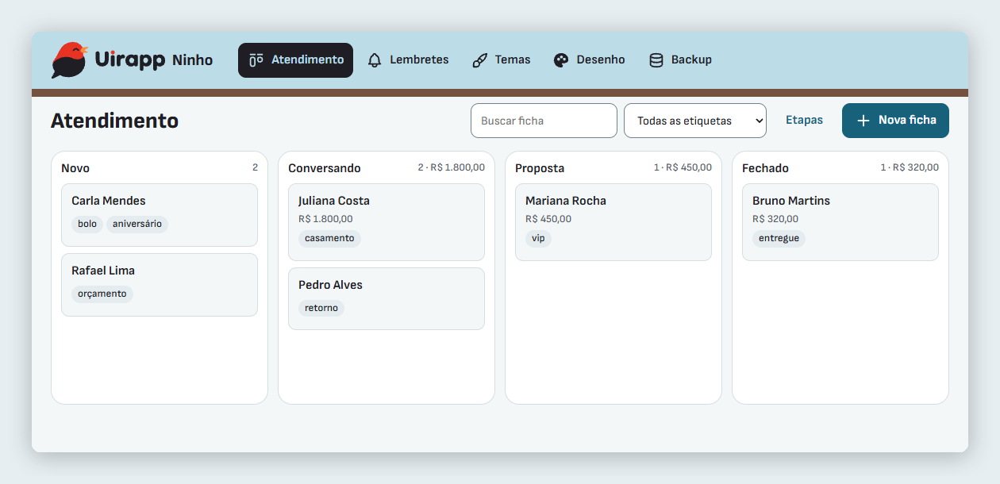

<p align="center">
  <picture>
    <source media="(prefers-color-scheme: dark)" srcset="marca/logo-horizontal-escura.svg">
    
  </picture>
</p>

# Uirapp

Extensão grátis para o WhatsApp Web: esconde conversas com Alt+S, guarda respostas prontas e troca o tema. Sem servidor.

**Português** | [English](README.en.md)

[Baixar](#baixar) · [Instalar](#instalar) · [O que faz](#o-que-faz) · [Privacidade](#privacidade-e-permissões) · [Reportar problema](https://github.com/FFloriani/uirapp/issues)

[](https://github.com/FFloriani/uirapp/releases/latest)
[](#compatibilidade)
[](https://github.com/FFloriani/uirapp/commits/main)



> [!NOTE]
> O Uirapp ainda não está na Chrome Web Store. Por enquanto, instale pelo arquivo ZIP, com o Modo do desenvolvedor ligado.

## Por que existe

- **A dor:** abrir o WhatsApp Web no trabalho, em chamada de vídeo ou com gente por perto mostra suas conversas. Quem atende cliente digita a mesma resposta o dia inteiro.
- **O que muda:** uma tecla cobre a tela inteira, e respostas, fichas e temas ficam no seu navegador, sem conta e sem servidor.
- **O que não faz:** não envia mensagem por você, não agenda envio e não dispara em massa. O Uirapp escreve no campo da conversa; quem aperta Enter é você.

## Baixar

| Quero | Arquivo | Observação |
|---|---|---|
| Instalar no Brave ou no Chrome | [uirapp.zip](https://github.com/FFloriani/uirapp/releases/latest/download/uirapp.zip) | Descompacte numa pasta que você não vai apagar |

SHA-256 em [SHA256SUMS.txt](https://github.com/FFloriani/uirapp/releases/latest/download/SHA256SUMS.txt) · Versões anteriores em [Releases](https://github.com/FFloriani/uirapp/releases)

## Instalar



1. Baixe o [uirapp.zip](https://github.com/FFloriani/uirapp/releases/latest/download/uirapp.zip) e descompacte numa pasta fixa, por exemplo `Documentos\uirapp`.
2. Abra uma aba e digite `brave://extensions` (no Chrome, `chrome://extensions`).
3. Ligue o **Modo do desenvolvedor**, no alto à direita. Deixe ligado: se desligar, o navegador desliga o Uirapp.
4. Clique em **Carregar sem compactação** e escolha a pasta que você descompactou, a que tem o arquivo `manifest.json` dentro.
5. Clique na peça de quebra-cabeça ao lado da barra de endereço e depois em **Uirapp**.
6. Clique em **Permitir e começar**.
7. Volte à aba do WhatsApp Web e aperte **F5**.

Para conferir: aperte **Alt+S** na aba do WhatsApp Web. As conversas viram passarinhos dormindo; Alt+S de novo mostra tudo.

<details>
<summary>Atualizar para uma versão nova</summary>

1. Baixe o `uirapp.zip` novo e descompacte **por cima da mesma pasta**, substituindo os arquivos.
2. Em `brave://extensions`, clique na seta de recarregar no cartão do Uirapp.
3. Volte à aba do WhatsApp Web e aperte F5.

Usar a mesma pasta mantém seus ajustes, respostas e fichas. Remover a extensão apaga esses dados: antes, faça um backup no Ninho.

</details>

## O que faz



- **Silêncio.** Alt+S esconde mensagens, prévias, nomes, fotos e mídias, tudo ou só o que você escolher. Pode ligar sozinho ao abrir a aba, ao sair dela ou depois de 1, 5, 10 ou 30 minutos parado. Junto, tira o som da aba e a contagem de mensagens do título.
- **Respostas prontas.** Digite `/atalho` e aperte Tab dentro da conversa. Aceita variáveis: `{saudacao}`, `{primeiro_nome}`, `{nome}`, `{data}`, `{hora}`, `{dia}`, `{assinatura}` e `{pix}`, que monta o código Pix copia e cola com a sua chave.
- **Aparência.** 14 temas para o WhatsApp, um estúdio para criar o seu com imagem de fundo, tamanho da letra e a opção de tirar da tela os filtros, as faixas, Status, Canais, Comunidades, Ligações e os desenhos do fundo.
- **Ferramentas.** Conversar com um número sem salvar o contato, **Compartilhar no WhatsApp** pelo botão direito em qualquer página, exportar a conversa aberta em texto, planilha ou página (a página pode ter senha) e baixar a foto ou o vídeo aberto.
- **Ninho.** Uma página própria com atendimento em etapas (fichas, etiquetas e valores), lembretes com aviso do computador, desenho e backup com senha.
- **Idiomas.** A extensão fala português, inglês e espanhol.



## Privacidade e permissões

O Uirapp não tem servidor, conta nem telemetria. As páginas da extensão são proibidas de abrir conexão (`connect-src 'none'`), e o teste automático confere que nenhum pedido sai dela. Ele não guarda suas conversas: guarda só os ajustes e o que você mesmo escreveu (respostas, fichas, lembretes e temas). Em **O que o Uirapp acessa**, na janela, o botão **Apagar dados do Uirapp** limpa tudo.

| O navegador pede | Para quê |
|---|---|
| Ler e alterar dados em `web.whatsapp.com` | Esconder a tela, aplicar o tema e escrever a resposta no campo. Não roda em nenhum outro site |
| `storage` | Guardar seus ajustes no navegador |
| `scripting` | Reforçar o estilo que esconde, para o site não conseguir passar por cima dele |
| `contextMenus` | O item **Compartilhar no WhatsApp** do botão direito |
| `alarms` e `notifications` | Avisar na hora de um lembrete |

O que ele **não** esconde: as notificações do computador e o que aparecer depois de você desligar ou remover a extensão e recarregar a página. Para as notificações, desligue-as no próprio WhatsApp Web.

As regras de segurança e como reportar uma falha estão em [SECURITY.md](SECURITY.md).

## Compatibilidade

- Testado no **Brave** e no **Google Chrome**. O pacote pede Chromium 120 ou mais novo; outros navegadores baseados no Chromium não foram testados.
- Só o WhatsApp Web no computador. O app do celular e o aplicativo de Windows não mudam.
- Quando o WhatsApp Web muda a página e o Uirapp não reconhece mais o que esconder, ele cobre a tela inteira e avisa **O WhatsApp mudou**, em vez de deixar algo à vista. Se isso acontecer, [abra uma issue](https://github.com/FFloriani/uirapp/issues/new/choose) dizendo a data e o navegador, sem print de conversa.

## Status

Feito por uma pessoa. Funciona e tem testes automáticos, mas ainda é cedo: espere mudanças a cada versão. A lista do que mudou está no [CHANGELOG.md](CHANGELOG.md).

## Compilar a partir do código

Precisa de Python 3 com Pillow e PyYAML (testado no Python 3.14).

```powershell
git clone https://github.com/FFloriani/uirapp.git
cd uirapp
python -m pip install pillow pyyaml
python scripts/montar.py
```

Saída esperada: `montado`. A extensão pronta fica em `extensao/uirapp` e o pacote em `extensao/uirapp-<versão>.zip`. Os testes e a estrutura das pastas estão no [CONTRIBUTING.md](CONTRIBUTING.md).

## Contribuir

Relato de problema e ideia são bem-vindos nas [issues](https://github.com/FFloriani/uirapp/issues). Antes de mandar código, abra uma issue para combinar: veja o [CONTRIBUTING.md](CONTRIBUTING.md).

## Créditos

- Fonte [Sofia Sans](https://github.com/lettersoup/Sofia-Sans), licença SIL OFL 1.1 ([`ui/fontes/OFL-sofia-sans.txt`](ui/fontes/OFL-sofia-sans.txt)).
- Ícones [Tabler Icons](https://tabler.io/icons) 3.51.0, licença MIT ([`ui/icones/LICENSE-tabler.txt`](ui/icones/LICENSE-tabler.txt)).
- O nome vem do uirapuru, o pássaro da lenda amazônica cujo canto faz a floresta silenciar.

O Uirapp não é afiliado, patrocinado nem aprovado pelo WhatsApp ou pela Meta. WhatsApp é marca da WhatsApp LLC.

## Licença

Ainda sem licença aberta: o código está público para leitura, e todos os direitos ficam reservados ao autor. A fonte e os ícones de terceiros seguem as licenças deles, citadas acima.
